<p align="center">
  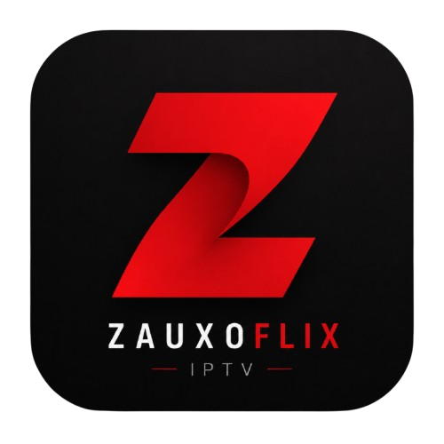
</p>

<h1 align="center">🎬 Zauxoflix — Multi-Platform IPTV & VOD Streaming Player 📺</h1>

<p align="center">
  <a href="https://flutter.dev"></a>
  <a href="https://dart.dev"></a>
  <a href="https://supabase.com"></a>
  <a href="https://riverpod.dev"></a>
  <a href="https://drift.simonbinder.eu"></a>
  <a href="https://github.com/ahmadteeb/Zauxoflix/releases"></a>
  <a href="LICENSE"></a>
</p>

<p align="center">
  <a href="#-multi-platform-support"></a>
  <a href="#-multi-platform-support"></a>
  <a href="#-multi-platform-support"></a>
  <a href="#-multi-platform-support"></a>
  <a href="#-multi-platform-support"></a>
  <a href="#-multi-platform-support"></a>
</p>

<p align="center">
  <a href="https://www.buymeacoffee.com/ahmadteeb" target="_blank"></a>
</p>

<p align="center">
  <a href="https://github.com/ahmadteeb/Zauxoflix/releases"><strong>Download Releases</strong></a> ·
  <a href="#-device--platform-installation-guides"><strong>Installation Guides</strong></a> ·
  <a href="https://github.com/ahmadteeb"><strong>Developer Profile</strong></a> ·
  <a href="https://www.buymeacoffee.com/ahmadteeb"><strong>Support Development</strong></a>
</p>

**Zauxoflix** is a high-performance, open multi-platform IPTV and VOD streaming application built with **Flutter** for **Android**, **Android TV**, **iOS**, **Linux**, **macOS**, **Windows**, **Samsung Tizen**, and **LG webOS**. Connect your own **Xtream Codes** credentials or **M3U / M3U Plus** playlists to stream Live TV with interactive XMLTV electronic programme guides (EPG), explore Movies and TV Series with season and episode breakdowns, download media for offline playback, resume watching across multiple devices with real-time cloud synchronization, pair TV screens effortlessly using cryptographic QR codes, and remotely control playback across your home devices.

> [!NOTE]
> **Zero Subscription & Bring-Your-Own-Content (BYOC)**: Zauxoflix does **not** provide, host, or bundle any media content, channels, or subscriptions. Bring your own IPTV service (Xtream Codes API or M3U/XMLTV playlist). The app has no subscriptions, activation fees, or paywalls. Video streams connect directly from your IPTV provider to your device.

---

## What's new in 1.1.0

- Home offers separate movie and series recommendations based on your library activity. The featured picks rotate, and the Top 10 charts show matching titles from your playlist.
- Global Search remembers recent searches and recently opened movies, series, and channels on this device. Clear the search field to see both lists. Use **Clear** beside a list to remove its entries.
- Live TV groups stream variants under one channel and brings regional channels and football broadcasters into dedicated collections.
- The player adds episode controls and seek previews on supported streams and devices. Downloads show storage checks and progress, with Wi-Fi-only and background transfers on Android and iOS.

See the [changelog](CHANGELOG.md) for the full release notes.

## Ratings, trailers, and discovery

Zauxoflix can use Trakt's public metadata for a movie or series. Details shows a sourced score, an IMDb title link when available, official YouTube trailers, and related titles found in your playlist. Saving a title to My List can add recommendations to Home. Zauxoflix uses Trakt but is not endorsed or certified by Trakt.

For a live build, register a [Trakt Development app](https://developer.trakt.tv/docs/create-an-app) and add `--dart-define=TRAKT_CLIENT_ID=YOUR_PUBLIC_CLIENT_ID` alongside the existing Supabase flags. Release workflows read the public client ID from the GitHub Actions repository variable `TRAKT_CLIENT_ID`. Request read-only Production access from Trakt before distributing a live integration. Zauxoflix sends title queries or IDs to Trakt and loads YouTube when you open a trailer.

### IMDb title and cast details for personal use

With a personal IMDb index installed, open a matched movie or series and scroll to **IMDb details**. Select a cast member to see their character, available birth and death years, professions, known-for titles, and IMDb profile. The app uses the exact IMDb title ID supplied by the playlist or Trakt when available. It can also identify a title offline by its name, release year and movie or series type when exactly one record matches. The synopsis comes from the playlist provider.

To build or refresh the index, run `python tool/import_imdb.py --output "/path/to/Zauxoflix/imdb.sqlite"` from `app`. Choose the app’s local application-support directory. On Windows it is normally `%APPDATA%\com.zauxoflix\zauxoflix`. On Linux it is normally `$XDG_DATA_HOME/com.zauxoflix.zauxoflix`, with `$XDG_DATA_HOME` defaulting to `~/.local/share`. The importer downloads four official compressed files. Pass `--datasets DIRECTORY` to reuse downloaded files. Reopen a title after the import finishes. [IMDb datasets](https://developer.imdb.com/non-commercial-datasets/) · [IMDb usage terms](https://help.imdb.com/article/imdb/general-information/can-i-use-imdb-data-in-my-software/G5JTRESSHJBBHTGX)

For a private Android or LG TV build, run `python tool/prepare_device_imdb.py --index /path/to/imdb.sqlite --library /path/to/zauxoflix.sqlite --output-dir assets/private_imdb` from `app` in the personal build checkout. This reads the library to select IMDb titles, ratings and cast. Only those IMDb records enter the generated asset. Build and install the app normally. The first lookup unpacks the index into app storage for offline use. Repeat the preparation and build after refreshing the IMDb data or changing the library. Keep generated assets and packages containing them for individual personal use. Public builds use a clean checkout with only `assets/private_imdb/README.txt` in that directory.

To try the isolated sample library on Windows, download the **Zauxoflix-Discovery-Preview-Windows** artifact from the **Windows discovery preview** workflow, extract the whole folder, and run `zauxoflix.exe`. You can also run `flutter run -d windows -t tool/discovery_preview.dart` from `app` with the Windows Flutter toolchain and NuGet installed. The preview uses an in-memory playlist and illustrative ratings. Open **Series → Severance**, play the trailer, switch between Episodes and More like this, then save the show and return Home. **The Office** is an ambiguous match. **Midnight Signal** demonstrates an unavailable trailer. Catalog playback uses the included sample clip. Trailer playback requires internet.

## ✨ Key Highlights

- ⚡ **100% Direct-to-Provider Streaming (Zero Video Proxying)**: Media streams connect directly between your device and your IPTV provider. Supabase never proxies video traffic or hosts your catalog.
- 📺 **Live TV with Integrated XMLTV EPG**: Instant category filtering, real-time channel search, inline video preview player, and rich electronic programme guide.
- 🍿 **VOD Movies & Series Catalog**: Category sorting, cast and crew metadata, season/episode tree selectors, favorites (My List), and seamless resume playback.
- 📱 **Adaptive Multi-Platform Form Factors**: Responsive design specifically engineered for Phones (bottom navigation + More sheet), Tablets, Desktop (window management & fullscreen), and 10-foot Living Room TVs (Android TV, Samsung Tizen, LG webOS with D-pad & remote control navigation).
- 📲 **Instant TV QR & Pairing Code Sign-In**: Frictionless 5-minute cryptographic TV sign-in using an on-screen QR code (scanned via phone camera on Android, iOS, and macOS) or an 8-character manual code—no typing passwords with TV remotes.
- 🎛️ **Cross-Device Remote Playback Control**: Cast, pause, seek, and control playback on other active devices and TVs linked to your account via Supabase Realtime event dispatching.
- 💾 **Local Offline Storage & Downloads**: Robust local SQLite cache powered by Drift for instant catalog loading, offline favorites, watch history, and offline media download support on supported devices.
- 🔄 **Real-Time Cross-Device Sync**: Automatic synchronization of favorites, watch history, and resume positions across all your devices using Supabase Postgres Changes and RPCs.
- 🎬 **Cinema-Grade Video Player**: Hardware-accelerated playback (`fvp` / libmdk) with aspect-ratio switching, subtitle track selection, multi-audio language switching, fast seeking, transport tooltips, and wakelock support.
- 🔒 **Enterprise-Grade Privacy & Security**: RPC-only database access, Row-Level Security, zero media proxying, and automatic credential redaction in the UI.
- ⚡ **IPTV Account & Provider Diagnostics**: Real-time inspection of Xtream account expiration date, active/max connections, provider server status, and last catalog synchronization time.
- 🔄 **In-App GitHub Release Update Checker**: Built-in update detector comparing semantic versions against GitHub Releases, with direct download asset links.

---

## 📱 Multi-Platform Support

Zauxoflix is designed to feel native on every screen size and input method:

| Platform | Target Form Factor | Input & Controls | QR Camera Scanner | Offline Downloads |
|---|---|---|:---:|:---:|
| 🤖 **Android** | Phone & Tablet | Touch, Gestures, Safe Areas | ✅ Supported | ✅ Supported |
| 📺 **Android TV / Fire TV** | 10-Foot Living Room | D-pad, Android TV Remote | 🔢 Manual Code Entry | ❌ N/A (TV Storage) |
| 🍏 **iOS** | iPhone & iPad | Touch, Gestures, Adaptive Layout | ✅ Supported | ✅ Supported |
| 🐧 **Linux** | Desktop & Laptop | Keyboard, Mouse, Hotkeys | 🔢 Manual Code Entry | ✅ Supported |
| 🍎 **macOS** | Desktop & Laptop | Keyboard, Trackpad, Native Window | ✅ Supported | ✅ Supported |
| 🪟 **Windows** | Desktop & Laptop | Keyboard, Mouse, Window Controls | 🔢 Manual Code Entry | ✅ Supported |
| 📺 **Samsung Smart TV (Tizen)** | 10-Foot Living Room | Samsung Remote, D-pad, Numbers | 🔢 Manual Code Entry | ❌ N/A (TV Storage) |
| 📺 **LG Smart TV (webOS)** | 10-Foot Living Room | LG Magic Remote, Pointer, D-pad | 🔢 Manual Code Entry | ❌ N/A (TV Storage) |

---

## 🖼️ Feature Tour & Visual Walkthrough

### 🏠 1. Home & Content Discovery
Browse featured hero banners with instant playback triggers, pick up where you left off with **Continue Watching** progress bars, and explore recently added movies and series.

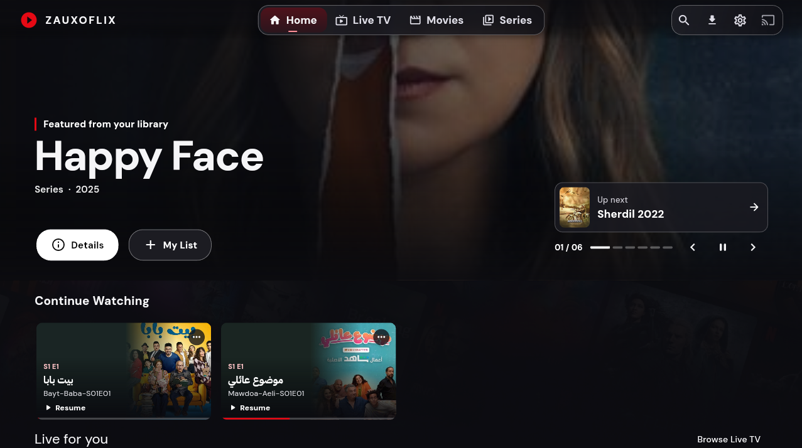

---

### 📺 2. Live TV & Electronic Programme Guide (EPG)
Switch channels effortlessly with category grouping, instant search, a real-time inline preview player, and a multi-day XMLTV electronic programme guide.

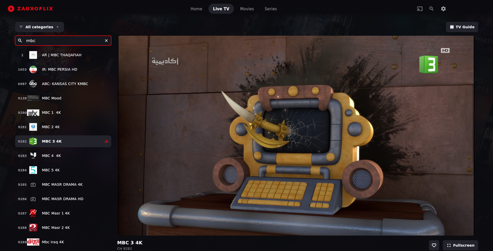

---

### 🎬 3. Movies Catalog
Explore full VOD movie catalogs with category filter chips, search filtering, title sorting, and one-tap **My List** favorites toggling.

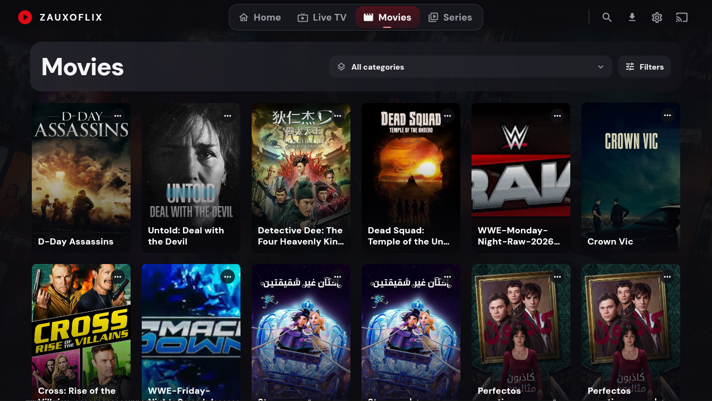

---

### 🍿 4. TV Series & Episode Explorer
Dive into television series with organized season selectors, episode overviews, thumbnails, and playback progress indicators.

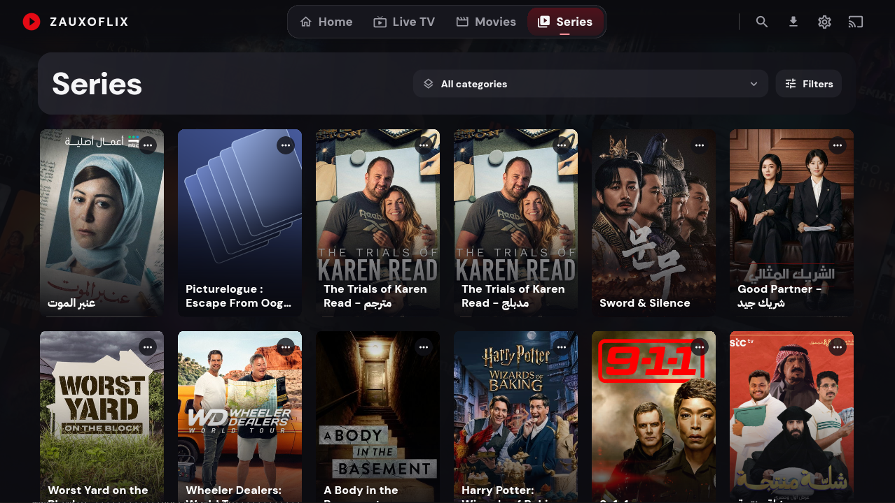

---

### 📋 5. Title Details & Season Selector
Inspect comprehensive title metadata, overview synopsis, category tags, episode listings, and direct resume/download triggers.

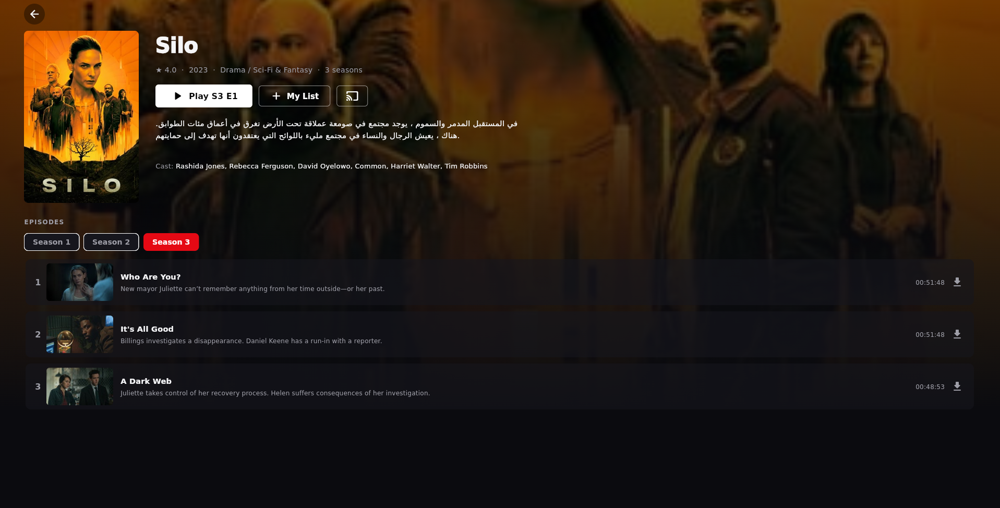

---

### ⏯️ 6. Cinema Player & Transport Controls
Experience hardware-accelerated playback with audio track selection, embedded subtitles, aspect ratio controls (Fit, Fill, Stretch, 16:9, 4:3), 48dp touch/remote friendly transport buttons, and desktop fullscreen mode.


---

### 📥 7. Offline Media Downloads
Download movies and series episodes directly to local device storage on supported platforms for watching on flights, commutes, or off-grid locations.

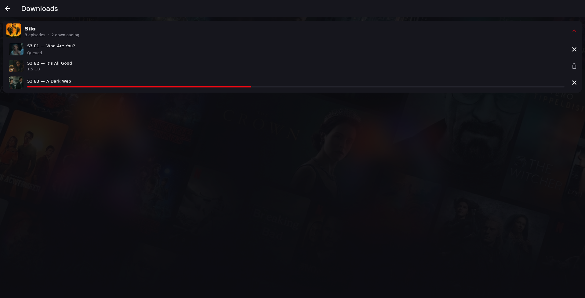

---

### 🔌 8. Connect Playlist & Provider Setup
Connect your IPTV service via **Xtream Codes API** (server URL, username, password) or standard **M3U / M3U Plus** playlist URLs with optional XMLTV EPG URLs.

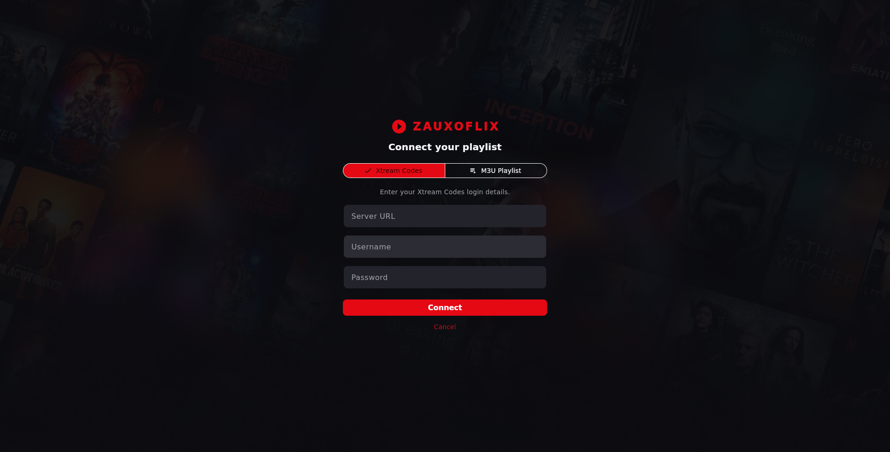

---

### 🔐 9. Authentication & Seamless TV Pairing
Sign in securely with email and password, reset passwords using secure recovery tokens, or pair your Android TV in seconds with a 5-minute QR code or pairing code.

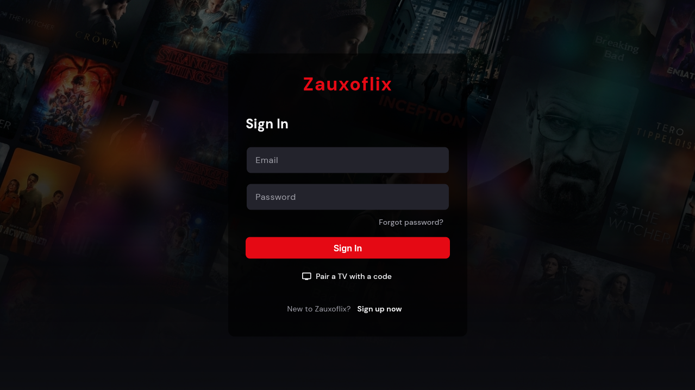

---

## 🛠️ Feature Matrix Summary

| Area | Feature & Capability |
|---|---|
| **Streaming Sources** | Xtream Codes API (Live, VOD, Series), M3U / M3U Plus playlists, external XMLTV EPG URLs. |
| **Media Player** | Hardware-accelerated decoding (`fvp` / `video_player`), multi-track subtitles, multi-audio selection, aspect ratios (Fit, Fill, Stretch, 16:9, 4:3), resumable positions, Wakelock. |
| **TV & Remote Ecosystem** | 5-minute cryptographic QR pairing, 8-character manual pairing code, cross-device remote control & command dispatching, 10-foot D-pad focus bridge. |
| **Sync & State Management** | Supabase Postgres Changes (Realtime), authenticated RPC mutations, conflict-free tombstones for favorites and watch history. |
| **Local Cache & Offline** | High-performance Drift (SQLite) database, instant local catalog search, offline favorites and watch history, direct HTTP media download manager. |
| **Security & Privacy** | Zero stream proxying (direct client-to-IPTV connection), unexposed database schemas (`app_data`, `private`), Row Level Security (RLS), credential masking in UI. |
| **Diagnostics & Settings** | Real-time IPTV provider account metrics (status, expiry, max/active connections), server info, semantic GitHub Release update checker. |

---

## 🔌 Connecting Playlists & Provider Diagnostics

Create an account, confirm your email if required by your deployment, sign in, and connect your playlist:
- **Xtream Codes API**: Requires your server address, username, and password.
- **M3U / M3U Plus**: Requires a playlist URL and optionally an XMLTV EPG URL.

### 🩺 IPTV Information & Provider Health
Navigate to **Settings → IPTV information** to view:
- **Provider Status**: Connection status, server origin, and last catalog synchronization.
- **Account Metadata**: Xtream accounts report subscription status, expiry date, maximum/active concurrent connections, account type, creation date, and output formats.
- **Security & Privacy**: Passwords, sensitive query parameters, and credential-bearing playlist URLs are permanently masked and never displayed in Settings summaries.

---

## 📺 Effortless TV Sign-In via QR Pairing

Signing in with complex passwords on Android TV remotes is tedious. Zauxoflix provides a secure 5-minute cryptographic pairing flow:

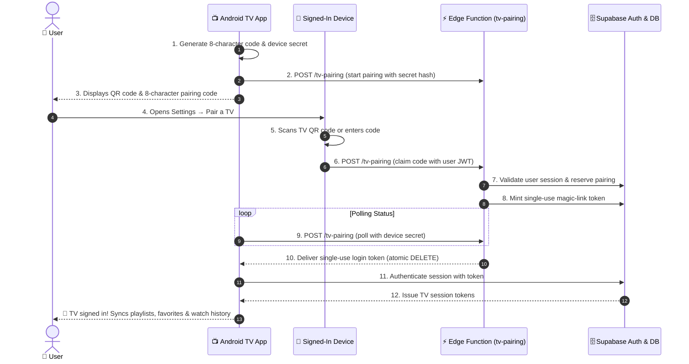

1. On your TV, select **Pair a TV with a code** to display the QR code and 8-character pairing code.
2. On your signed-in phone, tablet, or desktop, go to **Settings → Pair a TV → Scan QR code**.
3. Scan the TV screen (supported on Android, iOS, and macOS) or enter the code manually (available on all platforms).
4. Tap **Pair**. The TV immediately authenticates and synchronizes your playlist, favorites, and watch progress.

> [!TIP]
> Pairing codes expire after **5 minutes**. The QR payload contains only the public code and Supabase project identity; device secrets and session tokens are never transmitted via QR.

---

## ☁️ Supabase Cloud & Security Architecture

Zauxoflix uses a zero-trust, privacy-first Supabase backend architecture. App tables live in **`app_data`** and pairing tables live in **`private`**, completely outside the exposed Data API schemas.

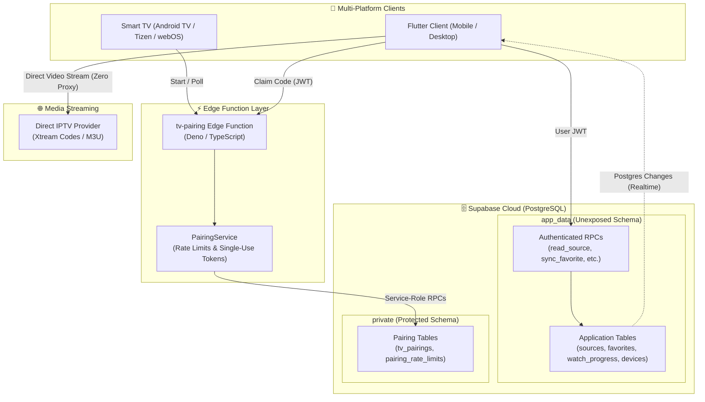

- **Unexposed Schemas**: Application tables reside in `app_data`, not `public`. Direct table access is blocked; interactions occur exclusively through authenticated PostgreSQL RPCs.
- **Row-Level Security (RLS)**: Enforced across all tables so accounts can only access their own playlists, favorites, watch progress, and devices.
- **Realtime Sync**: Postgres Changes deliver instant updates for favorites, watch history, and cross-device remote control commands.
- **TV Pairing Edge Function**: Runs on Deno with rate limiting, gateway address throttling, single-use token consumption, and cryptographic hash storage.

### 🛠️ Backend Setup & Deployment

1. Create a Supabase project at [supabase.com](https://supabase.com).
2. Enable email/password signups in **Authentication → Providers → Email**.
3. In **Authentication → Email Templates → Reset Password**, include `{{ .Token }}` in the template to enable in-app password recovery.
4. Install the Supabase CLI and sign in. From the repository root, preview the pending migrations for your fork's Supabase project.

```bash
supabase login
python supabase/scripts/update_database.py YOUR_PROJECT_REF
```

For a new project, rerun the script with `--apply --deploy-pairing` after reviewing the plan. Existing projects that have applied the four repository migrations can move to 1.1.0 without a Supabase schema update. The app upgrades its SQLite library on first launch. See the [database upgrade guide](supabase/README.md#deployment-and-checks).

> [!IMPORTANT]
> Never embed a `service_role` key in Flutter. Flutter only receives the project URL and the publishable (`anon`) key. See [Supabase architecture details](supabase/README.md).

In your GitHub fork, set `SUPABASE_URL` and `SUPABASE_ANON_KEY` as Actions secrets. Set the optional `TRAKT_CLIENT_ID` as an Actions variable. For local builds you can pass the Supabase values via `--dart-define-from-file=supabase.local.json` from `app`. Local config files and generated personal IMDb assets are ignored by Git.

---

## ⚙️ Installation & Getting Started

### 📋 Prerequisites

- **IPTV Provider**: An active Xtream Codes API account or M3U playlist URL.
- **Supabase Backend**: A configured Supabase project (see setup above).
- **Supported Operating System**:
  - Android 5.0+ (ARM64, ARMv7, x86_64)
  - Android TV / Google TV / Fire TV
  - iOS 13.0+
  - Linux (GTK 3.0+)
  - macOS 11.0+ (Apple Silicon & Intel)
  - Windows 10/11 (64-bit)

---

### 📦 Pre-Built Binaries

Download pre-built application packages directly from [GitHub Releases](https://github.com/ahmadteeb/Zauxoflix/releases):

- 🤖 **Android**: `Zauxoflix-<version>-android.apk` (Universal Phone, Tablet & Android TV APK)
- 🍎 **iOS / iPadOS**: `Zauxoflix-<version>-ios-unsigned.ipa` (unsigned; sign before installation)
- 🪟 **Windows**: `Zauxoflix-<version>-windows-x64.zip` (Portable 64-bit binary bundle)
- 🍏 **macOS**: `Zauxoflix-<version>-macos.dmg` (Disk Image) & `Zauxoflix-<version>-macos.zip` (Universal Binary)
- 🐧 **Linux**:
  - **Debian / Ubuntu / Pop!_OS**: `Zauxoflix-<version>-debian.deb`
  - **Arch Linux / Manjaro / EndeavourOS**: `Zauxoflix-<version>-Arch.pkg.tar.zst`
  - **Fedora / RHEL / openSUSE**: `Zauxoflix-<version>-fedora.rpm`
  - **Universal Linux**: `Zauxoflix-<version>-linux.AppImage`
  - **Generic Archive**: `Zauxoflix-<version>-linux-x64.tar.gz`
- 📺 **Samsung Smart TV (Tizen)**: `Zauxoflix-<version>-tizen.tpk` (unsigned; sign for your TV before installation)
- 📺 **LG Smart TV (webOS)**: `Zauxoflix-<version>-webos.ipk`

---

## 📥 Device & Platform Installation Guides

Follow the step-by-step instructions below to install Zauxoflix on your device:

### 🤖 Android (Phones & Tablets)
1. Download **`Zauxoflix-<version>-android.apk`** from [GitHub Releases](https://github.com/ahmadteeb/Zauxoflix/releases).
2. Open the downloaded `.apk` file on your device.
3. If prompted by Android, tap **Settings** and enable **Install Unknown Apps** for your browser or file manager.
4. Tap **Install** and launch **Zauxoflix**.

---

### 📺 Android TV / Google TV / Fire TV
Zauxoflix includes a native 10-foot living room interface optimized for remote controls and D-pad navigation.

#### Method 1: ADB Sideload (Recommended for Developers & Advanced Users)
1. On your TV, navigate to **Settings → Device Preferences → About** and click **Build Number** 7 times to enable Developer Mode.
2. Go to **Developer Options** and enable **Network Debugging / ADB Debugging**.
3. Note your TV's local IP address from **Settings → Network**.
4. From your computer terminal, connect and install:
   ```bash
   adb connect <TV_IP_ADDRESS>:5555
   adb install -r Zauxoflix-<version>-android.apk
   ```

#### Method 2: Downloader App (Recommended for Quick Living Room Setup)
1. Install the free **Downloader** app from the Google Play Store or Amazon Appstore on your TV.
2. In TV Settings, navigate to **Security & Restrictions** and grant Downloader permission to **Install Unknown Apps**.
3. Open Downloader, enter the download URL for **`Zauxoflix-<version>-android.apk`**, and follow the on-screen installation prompt.

---

### 🍎 iPhone & iPad (iOS / iPadOS)

CI produces **`Zauxoflix-<version>-ios-unsigned.ipa`** for physical iPhones and iPads. The IPA contains the release app in `Payload/Runner.app`; it is not a simulator build. No Apple certificate, provisioning profile, or signing password is needed to build it in CI.

**An unsigned IPA cannot be installed directly on a normal iPhone or iPad.** Sign it before installation using one of the methods below.

#### Method 1: AppleJR online signer (from your iPhone or iPad)

1. Download **`Zauxoflix-<version>-ios-unsigned.ipa`** from [GitHub Releases](https://github.com/ahmadteeb/Zauxoflix/releases) and save it in the **Files** app. Keep the `.ipa` file intact.
2. Open [AppleJR IPA Signer](https://applejr.net/#signer) in Safari on the device where you want to install Zauxoflix.
3. AppleJR currently lists its **AppleJr DNS** profile as a prerequisite for this method. Review the profile before deciding whether to install it; it changes device network settings. If you do not want that profile, use Method 2 below. Apple's [configuration profile instructions](https://support.apple.com/102400) explain how to review and install downloaded profiles.
4. Choose **Upload IPA**, tap the upload area, and select the downloaded Zauxoflix IPA from Files. This uploads the app to a third-party service; Zauxoflix does not operate AppleJR.
5. Under **Select Certificate from Server**, choose an available, valid certificate you are authorized to use. If none is suitable, use Method 2.
6. Tap **Sign IPA** and wait for signing to finish. Then tap **Install IPA** and accept the iOS installation prompt.
7. Once installation finishes, open Zauxoflix from the Home Screen. If iOS reports an untrusted enterprise developer, follow the trust instructions below.

For a manually installed enterprise-signed app, go to **Settings → General → VPN & Device Management**, select its developer, and establish trust only if you recognize and trust that developer. Depending on the iOS version, this may say **Trust** or **Allow & Restart**. Internet access is required for verification. See [Apple's enterprise app installation guide](https://support.apple.com/118254).

If installation fails or the app later reports **Unable to Verify App**, its certificate or provisioning may be expired, revoked, or incompatible with your device. A DNS profile does not make an invalid certificate valid. Re-sign with a valid signing identity using an appropriate installation method; avoid deleting an existing installation until you have considered its local downloads and data. AppleJR availability and successful signing/installation are not guaranteed. This workflow has been checked against the site's controls, but has not been tested on a physical iOS device.

#### Method 2: Sign and install using a computer

1. Download the unsigned IPA from [GitHub Releases](https://github.com/ahmadteeb/Zauxoflix/releases).
2. On macOS or Windows, use an IPA signing/install tool such as [Sideloadly](https://sideloadly.io/). Connect your device, trust the computer, select the IPA, and follow the tool's Apple account signing and installation instructions.
3. Enable [Developer Mode](https://developer.apple.com/documentation/xcode/enabling-developer-mode-on-a-device) and trust the developer profile in device Settings if requested.
4. Open Zauxoflix. Development signatures expire; refresh/re-sign using your signing tool when required. Keep the same signing identity and bundle identifier for updates.

For your own development build on a Mac, open `app/ios/Runner.xcworkspace` in Xcode, select the Runner target, configure **Signing & Capabilities** with your team and a unique bundle identifier, then run on your connected device. Public distribution requires a separately signed release through TestFlight/App Store; the unsigned GitHub IPA is not an App Store submission. See [Apple's distribution guide](https://developer.apple.com/documentation/xcode/distributing-your-app-for-beta-testing-and-releases).

---

### 📺 Samsung Smart TV (Tizen OS)

#### Native Flutter package for Tizen 6.0+

The **`Zauxoflix-<version>-tizen.tpk`** file in GitHub Releases is **unsigned**. Each user must sign it with a Samsung certificate profile that includes their TV's DUID before installing it. CI does not require or use Tizen certificate secrets. This is developer sideloading; installation through the Samsung TV Apps store is a separate distribution process.

#### Step 1: Install the signing tools

On your computer, install the Tizen SDK command-line tools (`tizen` and `sdb`) and Samsung certificate tools using the [Flutter Tizen SDK setup guide](https://github.com/flutter-tizen/flutter-tizen/blob/main/doc/install-tizen-sdk.md). The current supported setup uses the VS Code Tizen extensions; existing Tizen Studio installations can also provide these tools. You do not need Flutter or the Zauxoflix source code to sign a downloaded package.

Make sure `tizen` and `sdb` are available in your terminal. The commands below use Bash on Linux/macOS; on Windows use the equivalent SDK paths and `tizen.bat`.

#### Step 2: Enable Developer Mode and connect your TV

1. Connect the TV and computer to the same local network.
2. Open **Apps** (or **Apps → App Settings**, depending on the TV model) and enter **12345** with the remote's number pad.
3. Enable **Developer Mode**, enter your **computer's LAN IP address** as the host PC, and restart the TV.
4. Find the **TV's IP address** in its network settings, then connect:

   ```bash
   sdb connect <TV_IP_ADDRESS>:26101
   sdb devices
   ```

Replace `<TV_IP_ADDRESS>` with your TV's IP. Save the serial shown by `sdb devices`, for example `<TV_IP_ADDRESS>:26101`. See the [device connection guide](https://github.com/flutter-tizen/flutter-tizen/blob/main/doc/configure-device.md).

#### Step 3: Create a Samsung certificate profile for your TV

1. In the Samsung certificate manager, create a **Samsung → TV** profile named **`ZauxoflixTV`**. Use a Samsung certificate, rather than a generic self-signed Tizen certificate.
2. Create an author certificate and save its password. Sign in with your Samsung account when prompted.
3. Create a **Public** distributor certificate and include your connected TV's **DUID**. Copy the DUID from the SDK Device Manager if it is not populated automatically. The DUID is different from the IP address or SDB serial.
4. Finish creating the profile. If your device tools offer **Permit to install applications**, apply it to the connected TV.

Follow Samsung's [certificate creation instructions](https://developer.samsung.com/smarttv/develop/tools/additional-tools/vscode/creating-certificates.html). A command-line alternative is documented in [Samsung's certificate manager guide](https://github.com/Samsung/tizen-agent-skills/blob/main/tizen-sdk-skills/docs/certificate/certificate-manager-guide.en.md#samsung-online-ca-certificates); it still requires SDK tools, Samsung account login, and the target TV's DUID.

Keep your author certificate and password for future updates. To cover additional TVs, include their DUIDs in the distributor certificate and sign the package again.

#### Step 4: Sign the downloaded package

Download the `.tpk` from [GitHub Releases](https://github.com/ahmadteeb/Zauxoflix/releases). In the download directory, set the actual filename and sign a working copy:

```bash
PACKAGE="Zauxoflix-<version>-tizen.tpk" # Replace with the downloaded release filename.
mkdir -p signed
cp "$PACKAGE" "signed/$PACKAGE"
tizen package -t tpk -s ZauxoflixTV -- "signed/$PACKAGE"
```

Use the profile name you created if it differs from `ZauxoflixTV`. The signing command reports the output package location; use that file for installation. See the [Tizen package and installation command reference](https://docs.tizen.org/application/tizen-studio/common-tools/command-line-interface/).

#### Step 5: Install and launch

```bash
# Replace the serial with the value reported by sdb devices.
tizen install -n "$PACKAGE" -s "<TV_IP_ADDRESS>:26101" -- "$PWD/signed"
```

Open **Zauxoflix** from the TV's Apps screen after installation. For certificate errors, check that you signed the package, selected a Samsung TV profile, included this TV's DUID, and permitted installation where required. Updates must use the same author certificate as the installed app; changing it may require uninstalling the old app, which can remove local app data. Device OS and CPU compatibility still apply: signing does not make a package compatible with every TV model.


---

### 📺 LG Smart TV (webOS)
Install the **`Zauxoflix-<version>-webos.ipk`** package on compatible LG TVs running **webOS 26 Re:New or later**. The native Flutter runtime and LG plugins are required. [LG Flutter for webOS compatibility](https://github.com/lg-flutter-webos/flutter-webos/blob/main/doc/getting-started.md).

#### Step 1: Enable Developer Mode on LG TV
1. Install the official **Developer Mode** app from the LG Content Store on your TV.
2. Launch the Developer Mode app and log in with your free LG Developer account.
3. Toggle **Dev Mode Status** to **ON**.
4. Toggle **Key Server** to **ON**. Take note of the **IP address** and **Passphrase** displayed on the TV screen.

#### Step 2: Install via webOS CLI (`ares-cli`)
1. Install the official webOS CLI on your computer:
   ```bash
   npm install -g @webos-tools/cli
   ares-config --profile tv
   ```
2. Register your TV device:
   ```bash
   ares-setup-device
   ```
   *(Select `add`, name your device e.g. `my-tv`, enter the TV IP address, and port `9922`)*.
3. Fetch the developer encryption key from the TV:
   ```bash
   ares-novacom --device my-tv --getkey
   ```
   *(When prompted, enter the 6-character Passphrase displayed on your TV screen)*.
4. Install the application package:
   ```bash
   ares-install --device my-tv Zauxoflix-<version>-webos.ipk
   ```

After updating, open the app, pair it with your account, and relaunch it to check that the session persists. Use the TV remote to test Back, channel preview, fullscreen playback, and volume.

To build the package locally, set up the [LG Flutter SDK and NDK](https://github.com/lg-flutter-webos/flutter-webos/blob/main/doc/getting-started.md) on Linux, then run the same build script used by CI from the repository root:

```bash
bash app/tool/webos/build.sh --build-name=1.0.0 --build-number=1 \
  "--dart-define=SUPABASE_URL=$SUPABASE_URL" \
  "--dart-define=SUPABASE_ANON_KEY=$SUPABASE_ANON_KEY"
```

Set those variables to your project's URL and client publishable key before building. The package is generated under `app/build/webos/`.

---

### 🍏 macOS (Apple Silicon & Intel)
1. Download **`Zauxoflix-<version>-macos.dmg`** or **`Zauxoflix-<version>-macos.zip`** from [GitHub Releases](https://github.com/ahmadteeb/Zauxoflix/releases).
2. Double-click the `.dmg` file and drag **`Zauxoflix.app`** into your **`Applications`** folder.
3. **First Launch (Gatekeeper)**: If macOS displays an alert saying the developer cannot be verified:
   - Right-click (or Control-click) `Zauxoflix.app` in `/Applications` and select **Open** → click **Open**.
   - Alternatively, remove the quarantine attribute via Terminal:
     ```bash
     xattr -cr /Applications/Zauxoflix.app
     ```

---

### 🪟 Windows (10 / 11 64-bit)
1. Download **`Zauxoflix-<version>-windows-x64.zip`** from [GitHub Releases](https://github.com/ahmadteeb/Zauxoflix/releases).
2. Right-click the `.zip` file and select **Extract All...** to unpack the files to a directory of your choice (e.g. `C:\Program Files\Zauxoflix` or your user folder).
3. Open the extracted folder and double-click **`zauxoflix.exe`** to launch.
4. *(Optional)*: Right-click `zauxoflix.exe` → **Pin to Start** or **Send to → Desktop (create shortcut)**.

---

### 🐧 Linux (Universal & Native Packages)
Download the package matching your Linux distribution:

#### Debian / Ubuntu / Linux Mint / Pop!_OS
```bash
sudo apt install ./Zauxoflix-<version>-debian.deb
```

#### Arch Linux / Manjaro / EndeavourOS
```bash
sudo pacman -U ./Zauxoflix-<version>-Arch.pkg.tar.zst
```

#### Fedora / RHEL / CentOS / openSUSE
```bash
sudo dnf install ./Zauxoflix-<version>-fedora.rpm
# On openSUSE:
sudo zypper install ./Zauxoflix-<version>-fedora.rpm
```

#### Universal AppImage (Compatible with all distributions)
```bash
chmod +x Zauxoflix-<version>-linux.AppImage
./Zauxoflix-<version>-linux.AppImage
```

#### Standalone Portable Tarball
```bash
tar -xzf Zauxoflix-<version>-linux-x64.tar.gz
cd zauxoflix
./zauxoflix
```

---

### 🚀 Building & Running from Source

```bash
# 1. Clone the repository
git clone https://github.com/ahmadteeb/Zauxoflix.git
cd Zauxoflix

# 2. Install Flutter Dependencies
cd app
flutter pub get

# 3. Run on your connected device or desktop
flutter run \
  --dart-define=SUPABASE_URL=https://YOUR_PROJECT_REF.supabase.co \
  --dart-define=SUPABASE_ANON_KEY=YOUR_PUBLISHABLE_KEY

# Optional: Force Android TV mode on desktop/tablet for TV UI development
flutter run \
  --dart-define=SUPABASE_URL=https://YOUR_PROJECT_REF.supabase.co \
  --dart-define=SUPABASE_ANON_KEY=YOUR_PUBLISHABLE_KEY \
  --dart-define=TV_MODE=true
```

#### 📦 Building Release Packages

Pass the Supabase configuration flags along with semantic versioning parameters:

```bash
# Android APK
flutter build apk --release --build-name=1.0.0 --build-number=1 \
  --dart-define=SUPABASE_URL=https://YOUR_PROJECT_REF.supabase.co \
  --dart-define=SUPABASE_ANON_KEY=YOUR_PUBLISHABLE_KEY

# iOS device app (macOS with Xcode; unsigned)
flutter build ios --release --no-codesign --build-name=1.0.0 --build-number=1 \
  --dart-define=SUPABASE_URL=https://YOUR_PROJECT_REF.supabase.co \
  --dart-define=SUPABASE_ANON_KEY=YOUR_PUBLISHABLE_KEY

# Wrap the unsigned app in an IPA, matching CI (run from app/)
mkdir -p build/ios/unsigned/Payload
cp -R build/ios/iphoneos/Runner.app build/ios/unsigned/Payload/
(cd build/ios/unsigned && zip -r -y ../Zauxoflix-v1.0.0-ios-unsigned.ipa Payload)

# Linux Desktop
flutter build linux --release --build-name=1.0.0 --build-number=1 \
  --dart-define=SUPABASE_URL=https://YOUR_PROJECT_REF.supabase.co \
  --dart-define=SUPABASE_ANON_KEY=YOUR_PUBLISHABLE_KEY

# macOS Desktop
flutter build macos --release --build-name=1.0.0 --build-number=1 \
  --dart-define=SUPABASE_URL=https://YOUR_PROJECT_REF.supabase.co \
  --dart-define=SUPABASE_ANON_KEY=YOUR_PUBLISHABLE_KEY

# Windows Desktop
flutter build windows --release --build-name=1.0.0 --build-number=1 \
  --dart-define=SUPABASE_URL=https://YOUR_PROJECT_REF.supabase.co \
  --dart-define=SUPABASE_ANON_KEY=YOUR_PUBLISHABLE_KEY
```

---

## 🧪 Quality Assurance & Test Suites

Run the comprehensive automated test suites across the Flutter application and Supabase Edge Functions:

```bash
# Run Flutter Static Analysis & Unit/Widget Tests
cd app
flutter analyze --fatal-infos
flutter test

# Run Supabase Edge Function & Security Rule Tests (from repo root)
deno fmt --check supabase/functions supabase/tests
deno check supabase/functions/tv-pairing/index.ts
deno test --allow-read --allow-env --allow-sys supabase/tests/
```

> [!NOTE]
> Tests cover database permissions, account isolation, TV pairing, catalog synchronization, version comparisons, Settings flows, and responsive layouts across phone, tablet, desktop, and 1080p TV viewports. See [UI review and design system](docs/ui-review.md) for details.

---

## 🏗️ Technical Architecture & Stack

- **UI Framework**: [Flutter 3.x](https://flutter.dev) (Multiplatform Material 3, custom TV D-pad focus engine, responsive layout breakpoints).
- **State Management**: [Riverpod 3.x](https://riverpod.dev) (`flutter_riverpod` providers, stream providers, state notifiers).
- **Local Persistence & Caching**: [Drift 2.x](https://drift.simonbinder.eu) (Type-safe reactive SQLite ORM for offline catalog, search, and watch positions).
- **Backend & Cloud Sync**: [Supabase](https://supabase.com) (Authentication, PostgreSQL, Postgres Changes, RPCs, Edge Functions in TypeScript/Deno).
- **Video Engine**: [video_player](https://pub.dev/packages/video_player) paired with [fvp](https://pub.dev/packages/fvp) (libmdk hardware-accelerated video decoding engine for high-bitrate streaming).
- **Navigation & Routing**: [go_router 17.x](https://pub.dev/packages/go_router) with nested stateful shell branches and deep linking.
- **Networking & Downloads**: [Dio 5.x](https://pub.dev/packages/dio) with background download streams and configurable timeout policies.
- **Hardware Integrations**: [mobile_scanner](https://pub.dev/packages/mobile_scanner) (camera QR scanning), [qr_flutter](https://pub.dev/packages/qr_flutter) (high-contrast QR rendering), [wakelock_plus](https://pub.dev/packages/wakelock_plus) (screen keep-awake), and [window_manager](https://pub.dev/packages/window_manager) (desktop window controls).

---

## 📁 Repository Structure

| Path | Purpose |
|---|---|
| [`app/`](app/) | Flutter application source code, platform runners, and test suites |
| [`supabase/`](supabase/) | Supabase forward migrations, TV pairing Edge Function, and security tests |
| [`screenshots/`](screenshots/) | High-resolution application screenshots and brand logo |
| [`docs/`](docs/) | UI review, responsive layout testing matrix, and design-system specifications |

---

## ☕ Support & Donate

If you find **Zauxoflix** useful and would like to support its ongoing development, consider buying me a coffee!

<p align="left">
  <a href="https://www.buymeacoffee.com/ahmadteeb" target="_blank"></a>
</p>

---

## 👨‍💻 Developer

Developed with ❤️ by **Ahmad El-Khatib** · [GitHub: @ahmadteeb](https://github.com/ahmadteeb).

---

## 📄 License & Terms

Zauxoflix is **free to use**. The repository retains its proprietary source-code terms. See the project repository for details.

```text
Copyright (c) Ahmad El-Khatib (AhmadTeeb)
All rights reserved.
```
